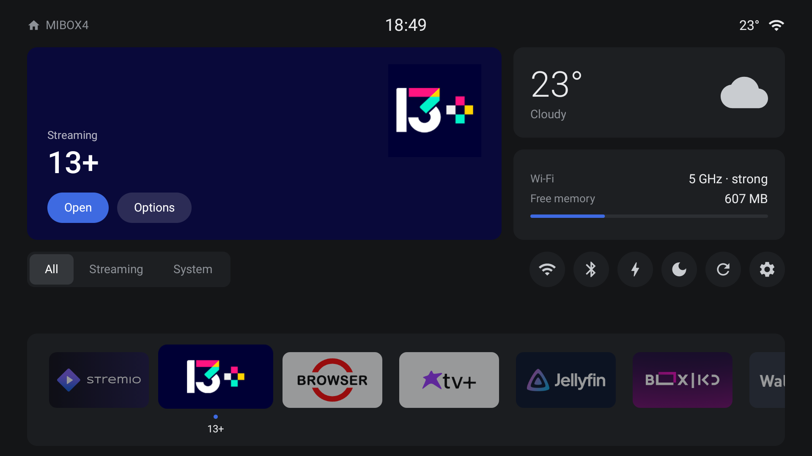

# Volt Launcher design system

This file is the source of truth for how Volt Launcher looks and behaves.
Read it before you change any UI. If a change breaks a rule here, change this
file in the same pull request and say why.

## 1. Design direction

**Tesla car UI on a TV.** We use the Tesla in-car screen as the model: a calm
dark canvas, one large primary area, small cards to its right, a row of round
quick controls, and a dock at the bottom. It does not use the Cybertruck chamfered
style. We tried it in early mockups, and the user selected rounded Tesla cards.

Principles, in priority order:

1. **Fast and light first.** The box has 2 GB RAM. A nice effect that costs RAM
   or frame time loses.
2. **Readable from the couch.** Large type for the thing in focus, quiet type for
   everything else.
3. **One accent.** Tesla blue marks focus and the primary action. Nothing else
   is blue.
4. **Calm.** No shadows, no glow, no gradients, no wallpaper bitmaps. Color
   comes from the focused app (the hero card) and from app banners only.
5. **The remote is the only input.** Every feature must work with D-pad, OK,
   Back, Home and Menu. No touch, no pointer.

## 2. Tokens

All colors are constants at the top of `HomeActivity.kt`. Use these names.

| Token     | Value       | Use                                             |
|-----------|-------------|-------------------------------------------------|
| `C_BG`    | `#141517`   | Window and screen background                    |
| `C_CARD`  | `#1D1F22`   | Cards, segmented control track, quick buttons   |
| `C_DOCK`  | `#1B1D20`   | Dock bar                                        |
| `C_SEL`   | `#34373B`   | Selected segment when the control is not focused |
| `C_TEXT`  | `#E9EAEC`   | Primary text                                    |
| `C_SEC`   | `#8D9197`   | Secondary text, labels                          |
| `C_ICON`  | `#C9CCD0`   | Icons on quick buttons (not focused)            |
| `C_BLUE`  | `#3E6AE1`   | Tesla blue: focus, primary button, progress     |
| `C_TRACK` | `#2C2F33`   | Progress bar track                              |

Hero card text: white, with secondary hero text at 70% white (`#B3FFFFFF`).
The Options pill is white at 14% (`#24FFFFFF`).

### Shape

| Element               | Radius          |
|-----------------------|-----------------|
| Cards, dock           | 12dp            |
| App tiles             | 9dp (baked into the bitmap, see 6) |
| Segmented control     | 9dp outer, 7dp segment |
| Pills (Open/Options)  | 18dp (full pill at 36dp height) |
| Quick buttons         | Circle, 42dp    |

### Type

System sans (Roboto on the box). Two weights only: regular and medium
(`sans-serif-medium`). Light (`sans-serif-light`) only for the big weather number.

| Use                 | Size  |
|---------------------|-------|
| Hero app name       | 36sp medium |
| Weather temperature | 42sp light |
| Status bar clock    | 20sp  |
| Body / values       | 14-16sp |
| Labels, category    | 13sp secondary |
| Dock tile name      | 12sp  |

Sentence case. No ALL CAPS, no letter-spacing tricks.

## 3. Layout

The screen is 960x540dp (1920x1080 at density 2). Outer padding is 32dp left and
right, 16dp top and 12dp bottom (TV overscan safe area).

From top to bottom:

1. **Status bar** (28dp): device name with a home icon on the left, clock in
   the center, temperature and Wi-Fi icon on the right.
2. **Top row** (228dp, 14dp gap):
   - **Hero card** (weight 1.75): background = dominant color of the focused app,
     animated. App icon top right (110dp). Bottom left: category, name, and the
     **Open** (blue) and **Options** pills.
   - **Right column** (weight 1): weather card above a system card (Wi-Fi band and
     strength, free memory with a 4dp progress bar).
3. **Middle row** (42dp, 14dp below): the segmented category control on the left
   and 6 round quick controls on the right (Wi-Fi, Bluetooth, free memory, screen
   saver, restart/about, settings).
4. **Dock** (bottom): bar with app tiles of 118x66dp in a horizontal scroll row.
   Under each tile: a 5dp blue dot and the app name, which show only on focus.
   Their space is always reserved so the layout does not jump.

## 4. Focus and motion

Focus is the most important visual state on a TV. Rules:

- **There is always exactly one focused view.** On start and on Home, focus
  goes to the first dock tile.
- **Dock tile focus:** scale 1.15, translate up 4dp, alpha 0.55 -> 1, dot and
  name visible. 150ms `ViewPropertyAnimator`.
- **Quick button focus:** background turns blue, icon turns white.
- **Quick button state:** a button that can be "on" (Wi-Fi, Bluetooth) shows a
  blue icon and a 4dp blue dot 4dp above the bottom of the circle when it is on
  and not focused. Focus wins: blue fill, white icon, no dot. States refresh
  every 5 s and on resume.
- **Pill focus:** 2dp white stroke, scale 1.05, 120ms.
- **Segmented control focus:** the selected segment turns blue. Left/Right
  changes the category at once.
- **Hero color:** ARGB `ValueAnimator`, 250ms, from the old color to the new one.
- Focused tiles stay centered in the dock with `smoothScrollTo`.
- Navigation map: Up from the dock goes to the middle row. Up from the middle row
  goes to the hero pills. Down goes back to the last focused dock tile. Set
  `nextFocus*` explicitly where the default focus search jumps diagonally.
- System animations on the target box run at 0.5x. Design for that, and do not
  depend on long animations.

## 5. Interaction

| Input                      | Action                              |
|----------------------------|-------------------------------------|
| OK on a tile, or Open      | Launch the app                      |
| Long-press OK, Menu, Options | App options                       |
| Back on home               | Nothing                             |
| Home while on home         | Reset to All and the first tile     |

App options open a bottom sheet (see "Bottom sheet" below). Rows: move (starts
move mode), category (shows the current one), hide from dock, app info, and
show hidden apps (shows the count). Back, Menu or Home closes the sheet.

### Move mode

OK on the "Move" row closes the sheet and starts live move mode for that tile.

- **Look:** the tile stays lifted (focus look: scale 1.15, up 4dp, full alpha)
  with a 3dp `C_BLUE` ring (9dp radius) and two 20dp blue chevrons, 6dp outside
  its left and right edges. The ring and chevrons are the image foreground
  drawable, so they scale with the tile and move no layout. A chevron is dimmed
  at the end of the row. The dot and the name are hidden.
- **Hint pill:** `C_BLUE`, white 13sp, fully rounded, "Left / Right move · OK done
  · Back cancel". Centered over the top edge of the dock bar (half above it). It
  is an overlay in the root frame, so showing it changes no layout.
- **Hero:** the sub line reads "Moving · position N of M" and updates each step.
- **Keys:** Left/Right move the tile one place (nothing at either end). The
  neighbor slides in 150ms. OK saves the order and does not launch the app.
  Back cancels and restores the old order. Home cancels, then resets as usual.
  Up, Down and Menu are ignored. A package list reload cancels move mode.
- **Saving:** the new order of the shown apps is merged into the full order. In a
  filtered category, apps that the filter hides keep their slots.

### Categories

The category list is user data (`Categories.kt`, pure logic). Defaults, in order:
All, Streaming, Music, Games, Tools, System. "All" is always first and cannot be
renamed, moved or deleted. Names have at most 24 characters.

- **Auto category** (`Categorizer.defaultCategory`, first match wins): 1) v1
  system rules (known system packages, system apps without a media hint) ->
  System; 2) `ApplicationInfo.category`: game -> Games, audio -> Music, video ->
  Streaming; 3) package name hints for tools (file managers, browser, VPN, speed
  test, downloader, terminal, adb, remote) -> Tools; 4) known media packages ->
  Streaming; 5) everything else -> Streaming.
- **Override:** the user can pick a category per app. It wins while the category
  exists. If an auto category was deleted, the app goes to Streaming, else to the
  first category, else to All.
- **Segmented control:** shows All and the categories that have apps, in list
  order. It lives in a horizontal scroll view (max 560dp, no scrollbar) and
  scrolls to keep the selected segment centered. If the current category becomes
  empty or is deleted, the control switches to All.
- **Picker sheet:** the "Category" row in the options sheet (value = current
  name, chevron) closes the sheet and opens a second one. Header sub line:
  "Choose a category". First row "Auto (name)", then one row per category except
  All. A blue check icon marks the current choice, and focus starts on it. OK sets
  or clears the override and closes the sheet.

### Settings screen

A second activity, `SettingsActivity.kt`, not exported, no launcher filter. It is
built in code with the same tokens as home. Open it with OK on the gear quick
control (long press still opens the Android settings) or with the "Launcher
settings" row at the end of the app options sheet.

- **Layout:** same outer padding as home. A 28dp title row ("Volt settings", 20sp
  `C_TEXT`), then two cards 12dp below it. Left card: `C_CARD`, 12dp radius,
  240dp wide, 12dp padding, the section rows, a divider and the "Android
  settings" row (chevron, opens the system settings). Right card: `C_CARD`,
  14dp gap, 22dp sides and 20dp top and bottom padding, a 22sp medium title and
  the rows of the selected section in a scroll view (no scrollbar).
- **Sections:** Weather (first, selected at start), Categories, Home cards, About
  Volt. The list is a plain `sections` list in code.
- **Rows:** the same row look as the sheet (`Rows.kt` builds both): 44dp, 9dp
  radius, 18dp icon, 16sp label, 15sp value. Focused: `C_BLUE` fill, white text
  and icon. A selected section that does not have focus shows `C_SEL`.
- **Focus rules:** focus starts on the first section. Focusing a section shows its
  detail at once (no OK). Right from a section goes to the first focusable detail
  row (nothing when there is none). Left from a detail row goes back to the
  selected section. Up and Down move inside a column and stop at the ends: no
  wrap and no escape to the other column. Back closes an open edit or action
  strip, else closes the screen.
- **Leaving:** the activity finishes in `onStop` when it is not already finishing.
  Home, the screensaver or an opened Android settings screen never leave it
  on top of the launcher.
- **Categories section:** one row per category (name, "N apps" or
  "Empty · hidden"; "All" shows "Always first" and has no actions) and a last
  "Add category" row (value "Limit reached" at 12 categories, including All).
  OK on a category opens a **pill strip** under the row: Rename, Move up, Move
  down, Delete. Pill: 13sp, 6dp/12dp padding, 14dp radius. Focused pill: white
  background with `C_BG` text. Others: `C_TRACK` with `C_TEXT`. A move that
  is not possible is dimmed and skipped. Left/Right move between pills.
  Up, Down and Back close the strip and focus the row. Move up and Move down
  save at once and keep focus on the same pill. Delete asks twice: the first OK
  changes the text to "Confirm delete", the second deletes; moving focus away
  resets the text. Deleted categories also lose their app overrides.
- **Rename and Add:** an inline text field row (blue 2dp stroke, hint "Category
  name", 24 characters, single line, Done key) with the TV keyboard. Done saves
  (an empty name cancels). Back cancels, even with the keyboard open. After Add
  the new row gets focus.
- **Toggle:** a 38x22dp pill track, `C_BLUE` when on and `C_TRACK` when off, with
  an 18dp white knob. On a focused (blue) row the track is darker blue when on
  and dark translucent when off, so it stays visible. OK switches it.
- **Weather section:** rows "City" (value: the city name or "Not set", chevron),
  "Temperature" (value °C or °F, OK toggles), "Update every" (15 min, 30 min or
  1 hour, OK cycles) and a plain note row (13sp `C_SEC`, no background): "Weather
  data from Open-Meteo. No account needed." The Weather card switch in Home
  cards stays the one on/off switch. The saved values live in the store; the
  `weather.*` keys of `local.properties` are only the default until a city is
  saved. Home reads the location, unit and interval in `onResume`; a changed
  city or unit refreshes the weather at once.
- **City page:** OK on the City row replaces the right panel (title "City"). First
  row: a search field (blue 2dp stroke, hint "Search a city", Done key). Typing
  searches 600 ms after the last change (2 characters or more); Done or Enter
  searches at once. A plain row shows "Searching…", "Can't reach Open-Meteo. Try
  again or pick from the list." or "No matches". Up to 5 result rows (map pin
  icon, name, value "admin1, country"); OK saves the city and returns to the
  Weather section with focus on the City row. Then a divider and the row
  "Pick from a list" (list icon, "No keyboard needed", chevron). Late search
  results are ignored. Network work runs on the background executor.
- **Search field keys:** the activity handles D-pad keys of the field itself.
  Down hides the keyboard and goes to the first result (or "Pick from a list").
  Up stays. Left at the start of the text goes to the section column; elsewhere
  it moves the cursor. Back closes the page at once, even with the keyboard open.
- **Preset page:** title "Pick a city". One row per large city (name, country), sorted by
  name, in a scroll list. OK saves and returns to the Weather section.
- **Pages:** Left from a City or Preset page returns to the section column and
  shows the Weather section again. Back returns to the Weather section (it does not
  close the screen).
- **No location:** the Weather card shows "Set a city in Volt settings" in
  `C_SEC` instead of the temperature and the icon. No network calls run and the
  status bar temperature is hidden.
- **Home cards section:** "Weather card" and "System card" switches (default on).
  Home reads them in `onResume`. Weather off: the card is gone, the weather
  timers do not run and the status bar temperature is hidden. System card off:
  the card is gone. Both off: the right column is gone and the hero card takes the
  full width. One off: the other card takes the full column height. The cards
  are not focusable, so no focus link changes.
- **About Volt section:** version, package and RAM budget as plain info rows, and
  a focusable "Source code" row that does nothing.

### Bottom sheet

An in-activity overlay, not a dialog window. Implemented in `Sheet.kt`.

- **Scrim:** full screen, `#A6000000`, not focusable.
- **Panel:** 560dp wide, centered at the bottom, `C_CARD`, top corners 16dp,
  padding 16dp (sides, top) and 20dp (bottom). A 36x4dp drag handle (`#3A3D42`)
  sits at the top.
- **Header:** 64x36dp app tile, name 18sp medium, sub line 13sp secondary, then a
  1dp divider (`#2C2F33`) and a 10dp gap.
- **Row:** 44dp high, 18dp side padding, 9dp radius. 18dp icon, 12dp gap, 16sp
  label. Optional value (15sp secondary), 16dp chevron and 16dp trailing icon (for
  example a check) on the right. Focused:
  `C_BLUE` fill, white label and icon, value `#DCE5FB`.
- **Focus:** the first row gets focus on open (or the row given as `focusIndex`). Up on the first row and Down on the
  last row stay put. Left/Right do nothing unless the row sets a handler. The
  screen below is blocked from focus. Focus returns to the previous view on close.
- **Motion:** slide up 150ms with the scrim fading in; close takes 120ms.
- **Height:** the rows sit in a scroll view (no scrollbar) and the panel is at most
  500dp high, so a long list (up to 12 categories) stays on the screen. Focus
  scrolls the focused row into view.

## 6. Implementation rules (performance)

- **Plain Android Views built in code.** No Compose, no RecyclerView, no
  AndroidX UI libraries, no image loading libraries. The Kotlin stdlib is fine.
- **RAM budget: about 30 MB PSS** on the Mi Box 4 (v1 measures 29-30 MB).
  Measure with `adb shell dumpsys meminfo io.github.kobiregev.volt` after each
  visual change. Any feature that adds more than 5 MB needs a reason.
- Scale every banner or icon down to its display size once and cache it
  (`Visuals.cache`, an LruCache of 16 MB).
- **Bake corner radii into bitmaps.** View outline clipping does not survive
  the focus scale animation.
- Any parent of a view that scales on focus needs `clipChildren = false` **and**
  `clipToPadding = false`. Without them, the zoom is cut to the old size and
  the rounded corners look square. We hit this bug in v1.
- Timers (clock, system card every 5 s, weather every 15, 30 or 60 min) run only while the
  activity is resumed.
- All disk, network and bitmap work runs on the single background executor.
  Post the results to the main thread.
- No personal data in the repo. The weather location is chosen on the box (the
  untracked `local.properties` file is only a default), and the device name comes from system settings.

## 7. Process for design changes

1. Make an HTML mockup first and get the user's approval before you write code.
   Show variants when the direction is open.
2. Build, install on the real box, take a screenshot with `adb shell screencap`,
   and look at it. A green build is not enough.
3. Measure RAM. Test focus with real key events
   (`adb shell input keyevent KEYCODE_DPAD_*`).
4. Update this file and `CHANGELOG.md`.
